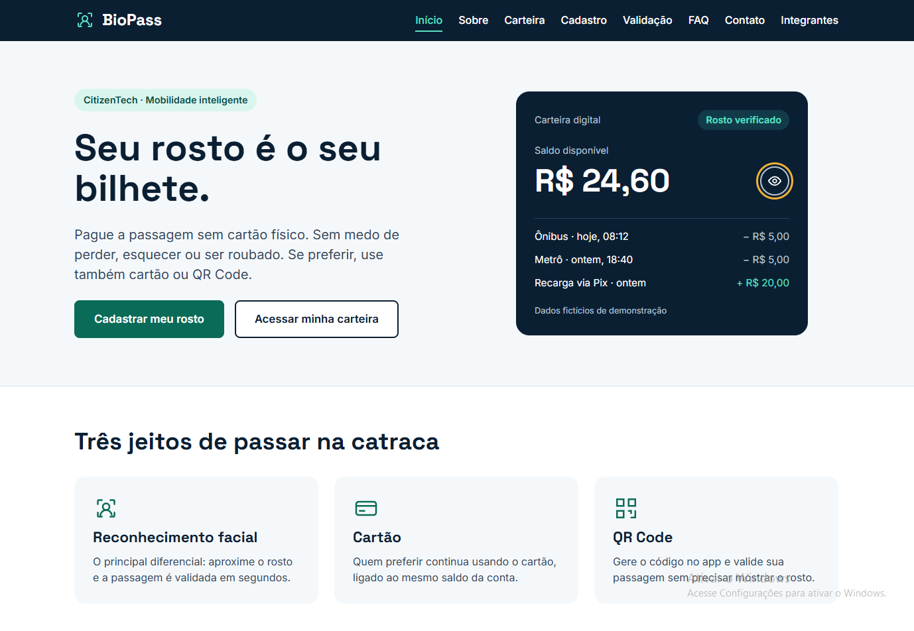
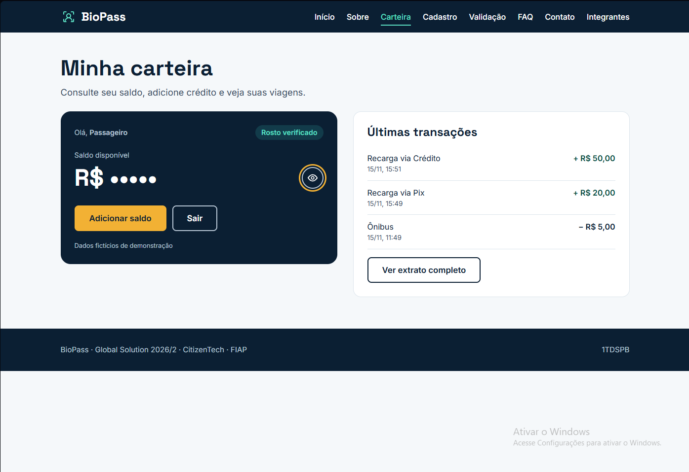
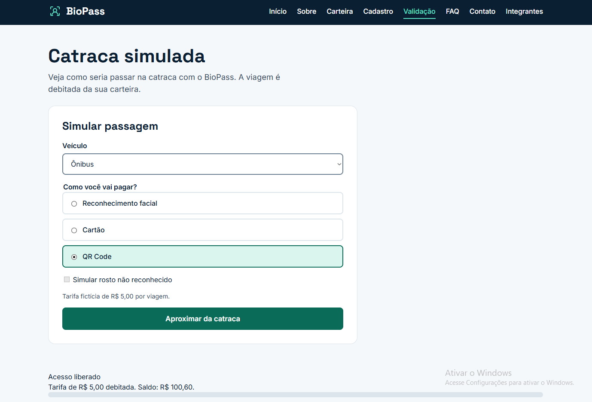

# BioPass — Front-End

> Seu rosto é o seu bilhete. Carteira digital de transporte público com validação por reconhecimento facial, cartão ou QR Code.

Projeto da **Global Solution 2026/2 — FIAP** (tema CitizenTech), disciplina Front-End Design Engineering.

**Repositório:** [COLE_AQUI_O_LINK_DO_REPOSITORIO]

> Protótipo acadêmico. O reconhecimento facial e os pagamentos são **simulações** com dados fictícios. Nenhuma foto é capturada ou armazenada.

## Sobre o projeto

Hoje o saldo do transporte fica gravado em um cartão de plástico: se ele é perdido, esquecido ou roubado, o passageiro perde tempo e dinheiro. O BioPass separa o saldo do objeto. O saldo fica na conta do passageiro, e a catraca o reconhece pelo rosto, pelo cartão ou pelo QR Code.

O site apresenta a solução e simula o fluxo completo do passageiro: cadastro, login, carteira, recarga, extrato e passagem na catraca.

## Páginas

| Página | O que faz |
|---|---|
| `index.html` | Apresentação do BioPass, com cartão de demonstração e saldo oculto |
| `sobre.html` | A ideia, como funciona, o que compõe o projeto e privacidade (LGPD) |
| `cadastro.html` | Cadastro com validação (CPF, e-mail, senha, Bilhete Único) e captura facial simulada |
| `carteira.html` | Login em modal, saldo com "olhinho", recarga (Pix, crédito, débito) e extrato |
| `validacao.html` | Catraca simulada (rosto, cartão ou QR Code) que debita a tarifa da carteira |
| `faq.html` | Perguntas frequentes |
| `contato.html` | Formulário de contato com validação e contador de caracteres |
| `integrantes.html` | Integrantes do grupo |

## Tecnologias

- HTML5 semântico
- CSS3 (variáveis, Flexbox, media queries, layout responsivo)
- JavaScript puro (sem frameworks ou bibliotecas)
- `localStorage` para simular o banco de dados e o login
- Fontes: Inter e Space Grotesk (Google Fonts)

## Interações em JavaScript

- Menu hambúrguer responsivo (`js/main.js`)
- Mostrar/ocultar saldo, no estilo de aplicativos de banco (`js/main.js` e `js/carteira.js`)
- Validação do formulário de contato (`js/contato.js`)
- Validação do cadastro, com máscara e verificação de CPF (`js/cadastro.js`)
- Login em modal, recarga em 3 etapas e extrato expansível (`js/carteira.js`)
- Catraca simulada (`js/validacao.js`)

## Estrutura de pastas

```
.
├── index.html
├── sobre.html
├── cadastro.html
├── carteira.html
├── validacao.html
├── faq.html
├── contato.html
├── integrantes.html
├── css/
│   └── estilo.css
├── js/
│   ├── dados.js        # dados simulados e validações
│   ├── main.js         # menu e saldo da página inicial
│   ├── cadastro.js
│   ├── carteira.js
│   ├── contato.js
│   └── validacao.js
├── assets/
│   └── img/
└── README.md
```

## Como executar

1. Baixe ou clone o repositório.
2. Abra o `index.html` no navegador (ou use a extensão Live Server do VS Code).

**Conta de teste** (dados fictícios): `demo@biopass.com` / senha `biopass123`.
**CPF válido para testar o cadastro:** `529.982.247-25`.

Para ver a recarga recusada, tente adicionar mais de R$ 300,00 (limite do protótipo).

## Responsividade

Testado em 390 px (celular), 768 px (tablet) e 1440 px (desktop).

## Autores

| Nome | RM | Turma | GitHub | LinkedIn |
|---|---|---|---|---|
| Marcos Paulo da Silva| RM 575557 | 1TDSPB | https://github.com/marcospaulo13 | https://www.linkedin.com/in/marcos-souza-50615b180/ |
| David Pucinelli | 576788 | 1TDSPB | https://github.com/DavidPucinelli | https://www.linkedin.com/in/david-pucinelli-b326a9257/ |
| Enzo Fukimoto | RM 575754 | 1TDSPB | https://github.com/Enzofukimoto | https://www.linkedin.com/in/enzo-câmara-a691b8318/ |
|Luiz Felipe Marques Gomes| RM 576768 | 1TDSPB |https://github.com/luizfelipe-m | https://www.linkedin.com/in/luiz-felipe-marques-gomes-036b90335/|

## Capturas de tela





## Uso de Inteligência Artificial

Utilizamos o **Claude (Anthropic)** como apoio no desenvolvimento do front-end: na estrutura do código HTML, CSS e JavaScript, na camada de dados simulada, nas validações dos formulários e em explicações do código. Todo o código foi revisado, testado e executado pelos integrantes do grupo.

## Contato

[E-MAIL_OU_CANAL_DE_CONTATO_DO_GRUPO]
